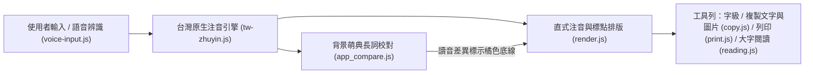

# AGENTS.md — 注音小幫手 (`zhuyin-app`) AI 開發與維護規範

本文件為 AI Agent 與開發者維護「注音小幫手 (`zhuyin-app`)」之核心架構指南與工程規範。進行任何修改前，請務必遵循以下準則。

---

## 1. 專案定位與核心架構

本專案為**純前端、零建置步驟（Zero-Build）、支援離線獨立運作（PWA）**的台灣教育部標準國字轉注音網頁應用程式。

### 檔案職責對照表

| 檔案路徑 | 核心職責 |
| :--- | :--- |
| `index.html` | 唯一主應用程式頁面（單一整合介面）。 |
| `about.html` | 獨立說明頁（版本資訊、PWA 安裝按鈕、開源詞庫與版權宣告）。 |
| `tw-zhuyin.js` | **核心台灣注音引擎**：封裝 `ButTaiwan/bpmfvs` 教育部審訂單字預設音（18,600+ 字）、完整破音字候選讀音表（3,235 個多音字，`getCharReadings`）、`poyin_db` 多音字前後文詞彙配對規則（530+ 字）與「一／不」變調邏輯。 |
| `app_compare.js` | **主頁面控制邏輯**：即時呼叫 `TaiwanZhuyin.textToTokens` 渲染注音，支援點擊任何多音字手動循環切換台灣讀音，並於背景對 2 字以上詞組查詢教育部萌典 API 進行交叉核對。 |
| `render.js` | **共用排版模組 (`ZhuyinRender`)**：負責直式注音符號、右上角聲調、輕聲頂部置中，以及標點符號黏著換行 (`attachPunctuation`)。 |
| `voice-input.js` | **語音輸入與手機輸入框自適應**：Web Speech API 即時預覽 (`interimResults: true`)、按需動態載入 (`Lazy Load`) `OpenCC` 簡轉繁單例快取、手機版 1～3 行整數行高動態縮放。 |
| `copy.js` / `print.js` / `reading.js` | 複製（HTML `<ruby>` 文字與 Canvas PNG 圖片）、A4 純結果列印、全螢幕大字閱讀模式。 |
| `sw.js` / `pwa.js` / `manifest.webmanifest` | **PWA 與離線快取**：HTML 採用 Network-First、靜態資源採用 Stale-While-Revalidate，支援自動熱更新 (`controllerchange` 自動重整)。 |
| `test.js` | **零依賴自動化測試與防呆檢查**：驗證台灣教育部讀音黃金語料、多音字候選表、聲調排版、`sw.js` 快取版號一致性與 SRI 資安規範（於 GitHub Actions 自動執行）。 |
| `fast.html` / `moedict.html` / `compare.html` | 舊版網址相容層（自動重新導向至 `index.html`），請勿刪除以免外部書籤失效。 |

---

## 2. 嚴格工程與領域規範 (Invariants)

### 2.1 讀音標準：100% 台灣教育部規範
- **嚴禁引入中國大陸普通話拼音庫**（如 `pinyin-pro`）：兩岸審音與輕聲詞尾差異極大，且簡體詞庫無法正確分詞繁體中文。
- **單字與助詞保底原則**：單字（如「呢 `˙ㄋㄜ`、的 `˙ㄉㄜ`、了 `˙ㄌㄜ`、還 `ㄏㄞˊ`」）一律以 `tw-zhuyin.js` 的台灣教育部審訂表第一常用讀音與前後文規則為準；萌典 API 僅用於 **2 字以上完整詞組** 的背景校對，禁止以萌典單字「釋義條數最多 (`d.length`)」覆蓋本地讀音。
- **變調相容**：「一」、「不」之口語連讀變調（如「不錯 `ㄅㄨˊ ㄘㄨㄛˋ`」與辭典原調 `ㄅㄨˋ ㄘㄨㄛˋ`）在比對時視為同音（`isToneSandhiEquivalent`），不得誤標為差異字。

### 2.2 排版與行動端 UX 規範
- **注音符號排版**：必須透過 `ZhuyinRender.bopoHtml` 產生；二、三、四聲標於右上角外緣（`.tone-mark`），輕聲標於正上方中央（`.tone-light`），詳見 `docs/zhuyin-guide.md`。
- **手機版空間極大化**：
  - 首頁不放置 `<footer>`，版本號與版權宣告一律收納於 `about.html`。
  - 手機版（`<= 768px`）採用 `flex-direction: column-reverse`（結果區在上、輸入框在下貼齊虛擬鍵盤），高度由 `visualViewport` 與 `voice-input.js` 的 `autoResize()`（1～3 行整數行高）嚴格控制。
  - 所有小型按鈕在手機版必須透過 `::after` 偽元素維持至少 `44x44px` 的無障礙觸控熱區。

### 2.3 快取更新與 PWA 規範
- 每次修改 `style.css` 或任何 `.js` 檔案時，必須同步遞增：
  1. `index.html` / `about.html` 內的 `?v=N` 查詢參數。
  2. `sw.js` 內的 `CACHE_NAME` 版本號與 `CORE_ASSETS` 對應參數，確保已安裝之獨立 Web App 自動觸發熱更新。

### 2.4 資安與隱私規範
- **外部 CDN 腳本必須具備 SRI**：任何外部 `<script>` 必須附上 `integrity="sha384-..."` 與 `crossorigin="anonymous"`。
- **禁止硬編碼敏感資訊**：Commit 訊息與原始碼中不得包含本機絕對路徑（如 `/home/...`）、API 金鑰或個人隱私資訊。

---

## 3. 分支與自動部署流程 (CI/CD)

本專案透過 GitHub Actions (`.github/workflows/`) 自動部署至 Firebase Hosting：

| 分支 | 對應環境 | 網址 | 觸發方式與權限限制 |
| :--- | :--- | :--- | :--- |
| **`main`** | 測試站 (`dev` target) | `https://zhuyin-dev.web.app` | Push 或 Merge PR 至 `main` 自動部署（同時更新 GitHub Pages）。日常開發與修改僅可推送至 `main`。 |
| **`release`** | 正式站 (`prod` target) | `https://zhuyin.web.app` | **嚴格限制：必須經過使用者明確同意並下達 Release 指令後**，才可將 `main` 合併並推送至 `release` 分支（`git push origin main:release`）。嚴禁 AI 自行推送至 `release`。 |

### 標準發布步驟
1. 於 `main` 完成開發，執行 `node test.js` 與 `node --check *.js` 驗證無誤。
2. 推送至 `main` 並在測試站 `https://zhuyin-dev.web.app` 交由使用者驗證功能。
3. **等待使用者明確同意 Release 後**，才可同步更新 `about.html` 版本號、合併至 `release` 分支並打上 Git Tag（如 `v1.2.0`）。
