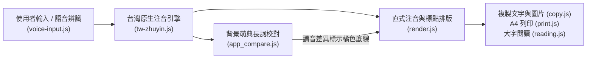

# 注音小幫手 (`zhuyin-app`)

**輸入中文，立即轉換為台灣教育部標準注音符號。**  
純前端、零延遲、支援離線獨立運作（PWA）的繁體中文國字轉注音工具，專為家長、教師、學生與文字工作者打造。

- 🌐 **正式站（Production）**：[https://zhuyin.web.app](https://zhuyin.web.app)
- 🧪 **測試站（Staging / Dev）**：[https://zhuyin-dev.web.app](https://zhuyin-dev.web.app)
- 📖 **技術指南**：[國字直式注音網頁排版技術指南 (`docs/zhuyin-guide.md`)](docs/zhuyin-guide.md)

---

## ✨ 核心特色

1. **100% 台灣教育部標準讀音（離線零延遲）**
   - 內建台灣開源社群字嗨 **[`ButTaiwan/bpmfvs`](https://github.com/ButTaiwan/bpmfvs)** 詞庫，收錄教育部《國語一字多音審訂表》與《重編國語辭典》**18,600+ 繁體字**預設第一讀音。
   - 內建 **530+ 個常見多音字**前後文詞彙配對規則（`poyin_db`），並自動處理「**一／不**」口語連讀變調（如「不錯 `ㄅㄨˊ ㄘㄨㄛˋ`」、「還錢 `ㄏㄨㄢˊ ㄑㄧㄢˊ` vs 還有 `ㄏㄞˊ ㄧㄡˇ`」）。
2. **多音字手動點擊切換 + 教育部萌典背景校對**
   - **手動切換**：收錄 **3,235 個多音字**的所有台灣審訂候選讀音，點擊結果區任何多音字（點狀底線）即可循環切換讀音。
   - **智慧校對**：連網時自動於背景向 **g0v 教育部萌典 API** 核對 2 字以上詞組，讀音差異以**橘色底線**標示，點一下即可切換。
3. **直式注音與標點黏著排版**
   - 嚴格遵循台灣教育部直式注音規範：二、三、四聲標於右上角外緣，輕聲（`˙`）標於正上方中央。
   - 標點符號自動與相鄰國字黏著換行（避頭點、避尾點），不會發生標點孤立於行首或行尾的問題。
4. **豐富教學與實用工具**
   - **語音輸入（國語）**：支援邊講邊即時預覽文字並同步轉換注音，按需自動載入 OpenCC 將簡體語音結果轉為台灣正體。
   - **複製文字／圖片**：一鍵複製帶 `<ruby>` 注音的 HTML（可貼入 Word、Google 文件繼續編輯）或高解析度 PNG 圖片（可貼入 LINE、簡報）。
   - **A4 純結果列印 & 全螢幕大字閱讀模式**：適合課堂投影、教材製作與低年級學童閱讀。
5. **PWA 獨立 Web App 與離線支援**
   - 可安裝至手機主畫面（iOS / Android）與電腦桌面（Chrome / Edge），無網路（飛航模式）亦可完整使用。

---

## 🏗️ 系統架構



| 檔案 | 職責說明 |
| :--- | :--- |
| `index.html` / `about.html` | 主應用程式頁面與獨立說明／版權宣告頁。 |
| `tw-zhuyin.js` | 台灣教育部標準單字讀音、3,235 多音字候選表、`poyin_db` 前後文規則與變調引擎。 |
| `app_compare.js` | 即時轉換渲染、多音字點擊切換、背景萌典長詞校對與無障礙鍵盤操作。 |
| `render.js` | 共用直式注音 HTML 結構（`bopoHtml`）、聲調拆解（`splitTone`）與標點黏著換行（`attachPunctuation`）。 |
| `voice-input.js` | Web Speech API 即時預覽、OpenCC 按需動態載入（含 SRI 驗證）與手機輸入框 1～3 行自適應高度。 |
| `copy.js` / `print.js` / `reading.js` | `<ruby>` 文字與 Canvas PNG 圖片複製、A4 列印、全螢幕大字閱讀模式。 |
| `sw.js` / `pwa.js` / `manifest.webmanifest` | PWA Service Worker 離線快取與自動熱更新機制。 |
| `test.js` | 零依賴自動化單元測試與 PWA 快取版號／SRI 資安防呆檢查。 |

---

## 🛠️ 本地開發與測試

本專案採用 **Zero-Build（零建置步驟）** 原生前端架構，無需安裝任何 `npm` 套件即可直接執行與測試：

```bash
# 1. 執行單元測試與快取版號／資安防呆檢查
node test.js

# 2. 啟動本地靜態伺服器預覽（任選一種）
npx serve .
# 或
python3 -m http.server 8080
```

### 部署流程（CI/CD）
- **測試站（`main` 分支）**：推送或合併 PR 至 `main` 分支時，GitHub Actions 會自動執行 `node test.js` 並部署至 `https://zhuyin-dev.web.app`。
- **正式站（`release` 分支）**：於測試站驗證無誤並經維護者確認後，將 `main` 合併至 `release` 分支即自動部署至 `https://zhuyin.web.app`。

---

## 📜 開源授權與致謝

本專案原始碼採用 **[MIT License](LICENSE)** 授權。專案所使用之第三方開源詞庫與政府公開資料詳見 **[THIRD_PARTY_NOTICES.md](THIRD_PARTY_NOTICES.md)**：

- **字嗨注音詞庫（[ButTaiwan/bpmfvs](https://github.com/ButTaiwan/bpmfvs)）**：Apache License 2.0 / MIT License。
- **教育部國語辭典 & g0v 萌典（[moedict.tw](https://www.moedict.tw/)）**：CC BY-ND 3.0 台灣 / 政府資料開放授權條款。
- **OpenCC 簡繁轉換（[nk2028/opencc-js](https://github.com/nk2028/opencc-js)）**：MIT License。
