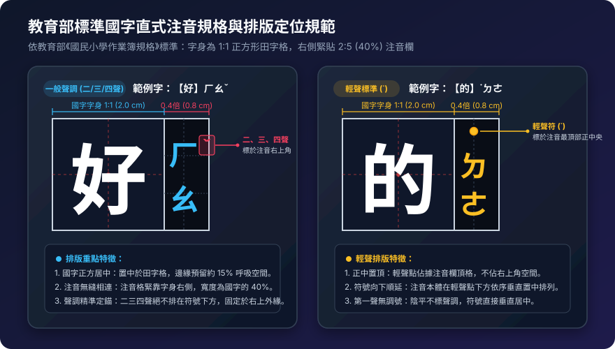
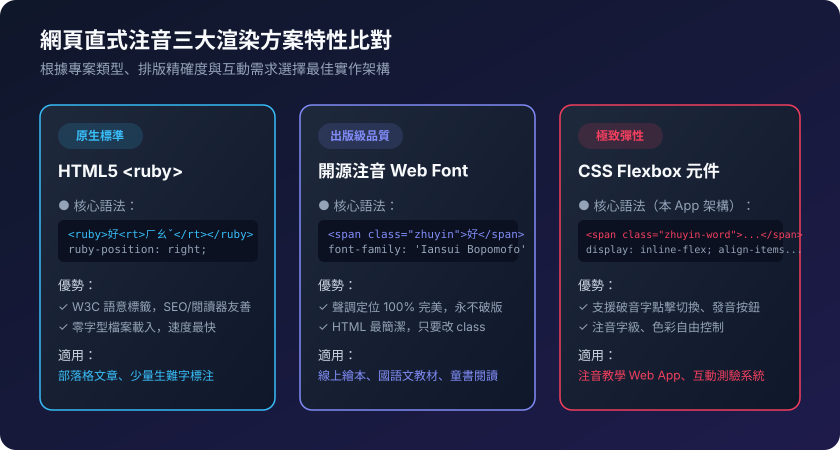

# 網頁與 Web App 直式注音實作技術指南 (Web & App Guide)

本指南專注於**現代網頁前端與 Web 應用程式 (Web App)**，探討如何精確、高效且美觀地呈現**國字右側直式注音**，並提供針對「生難字/破音字選擇性標注」、「編輯器 Markdown 語法解析」與「富文本匯出」的完整前端實作範例。

---

## 一、直式注音排版標準與聲調定位

在進行前端網頁排版時，需遵循教育部《國民小學作業簿規格》對國字右側直式注音的標準版面結構：



> 💡 **教育部標準規格**：
> 1. **字身格（國字）**：為 **$1 : 1$ 正方形田字格**（如標準作業簿之 $2.0 \times 2.0\text{ cm}$），國字水平與垂直精準居中，四周預留約 15% 呼吸邊距。
> 2. **注音欄**：緊貼於字身右側（無額外間隙），寬度固定為國字寬度的 **$2 : 5$（約 40%，即 $0.8\text{ cm}$）**。
> 3. **一般聲調（二聲 ˊ、三聲 ˇ、四聲 ˋ）**：固定標示於注音符號本體的**右上角外緣**。
> 4. **輕聲（˙）**：獨立排於注音首個符號的**正上方中央**。
> 5. **第一聲（陰平）**：**不標任何符號**。

---

## 二、網頁端三大渲染方案特性比較

根據專案對「效能、版面精緻度、使用者互動（如破音字點選）」的需求不同，網頁主要有以下三種實作架構：



---

## 三、方案深入解析與前端代碼

### 方案 1：W3C 標準 `<ruby>` 標籤 + 現代 CSS（標準語意、免載入）
利用瀏覽器原生的注音標籤。現代瀏覽器（Chrome 84+、Firefox 78+、Safari 14+）已完整支援 `ruby-position: right`。

#### 適合場景：
* 部落格長篇文章、電子書、閱讀器。
* 注重 SEO 與螢幕報讀軟體（Accessibility / 無障礙）的內容網站。

#### 範例程式碼：
```html
<p class="article">
  這是一篇需要標注
  <ruby class="bopo-ruby">難<rt>ㄋㄢˊ</rt></ruby>
  <ruby class="bopo-ruby">字<rt>ㄗˋ</rt></ruby>
  的標準文章。
</p>

<style>
  /* 將注音置於國字右側 */
  ruby.bopo-ruby {
    ruby-position: right;       /* W3C 標準：置於右側 */
    margin-right: 0.35em;       /* 預留字距，避免與後續文字重疊 */
  }

  ruby.bopo-ruby rt {
    font-size: 0.45em;          /* 注音字級約為國字的 45% */
    writing-mode: vertical-rl;  /* 注音符號直排 */
    letter-spacing: -1px;       /* 讓符號銜接更緊湊 */
    color: #4f46e5;             /* 注音專用強調色彩 */
    user-select: none;          /* 避免使用者複製內文時反白到注音符號 */
  }
</style>
```

---

### 方案 2：開源注音 Web Font（印刷級排版、純文字渲染）
透過引入開源字體（如台灣開發的「芫荽注音」或「源流注音」），直接輸入一般國字，字型內部即自動渲染完美的直式注音與聲調。

#### 適合場景：
* 兒童數位繪本、國語文線上教材、長篇需精確聲調的教材頁面。

#### 範例程式碼：
```html
<!-- 引入開源芫荽注音 Web Font (Iansui Bopomofo) -->
<link rel="stylesheet" href="https://cdn.jsdelivr.net/npm/iansui-bopomofo@latest/css/iansui-bopomofo.css">

<style>
  body {
    font-family: system-ui, -apple-system, sans-serif;
    font-size: 20px;
    line-height: 2;
  }

  /* 僅對特定需要標注的字詞加上 Class */
  .with-zhuyin {
    font-family: 'Iansui Bopomofo', serif;
  }
</style>

<p>
  一般內文使用普通字體顯示，只有遇到生字詞如「<span class="with-zhuyin">魑魅魍魎</span>」時才套用注音字型。
</p>
```

> 💡 **字體體積優化提醒**：全套中文字型檔通常較大（數 MB），在生產環境中建議配合動態字體子集化（Font Subsetting）或 Google Fonts 類似的 Slice 載入機制。

---

### 方案 3：自訂 Flexbox / Grid 元件（Web App 極致彈性、支援互動）
這是本專案（`zhuyin-app`）採用的架構。將國字與注音符號包裹在獨立的容器中，透過 CSS Flexbox 實現精準的垂直直排與聲調絕對定位。

#### 適合場景：
* 線上注音轉換小工具、互動測驗系統、教學 Web App。
* 需要支援「點擊破音字更換讀音」、「發音播放」、「動態調整注音顏色/大小」的高互動介面。

#### HTML 元件結構：
```html
<span class="zhuyin-word">
  <span class="zhuyin-char">好</span>
  <span class="zhuyin-bopomofo">
    <span class="bopo-chars">ㄏㄠ</span>
    <span class="bopo-tone tone-3">ˇ</span>
  </span>
</span>
```

#### CSS 佈局與定位：
```css
.zhuyin-word {
  display: inline-flex;
  align-items: center;
  vertical-align: baseline;
  margin-right: 0.4em;
}

.zhuyin-char {
  font-size: 1.25rem;
  line-height: 1;
}

.zhuyin-bopomofo {
  position: relative;
  display: inline-flex;
  flex-direction: column;
  font-size: 0.5rem;
  margin-left: 2px;
  line-height: 1;
  color: #6366f1;
  user-select: none; /* 複製時不干擾國字 */
}

.bopo-chars {
  writing-mode: vertical-rl;
  letter-spacing: -0.5px;
}

/* 聲調定位：固定在右上角 */
.bopo-tone {
  position: absolute;
  top: 0;
  right: -0.7em;
  font-size: 0.8em;
}

/* 輕聲定位：置於最頂部中央 */
.bopo-tone.tone-light {
  position: static;
  display: block;
  text-align: center;
  margin-bottom: -2px;
}
```

---

## 四、Web App 進階實戰應用技巧

### 1. 編輯器語法擴充：自訂類 Markdown 注音解析器
若您希望讓使用者在輸入框中以輕量語法指定單字注音（例如 `[好](ㄏㄠˇ)`），可在前端加上此轉換函式：

```javascript
/**
 * 將類似 Markdown 的標記 [國字](注音) 轉換為標準直式 HTML
 */
function parseZhuyinMarkdown(input) {
  return input.replace(/\[([^\]]+)\]\(([^)]+)\)/g, (match, char, bopomofo) => {
    return `
      <ruby class="bopo-ruby">
        ${char}<rt>${bopomofo}</rt>
      </ruby>
    `;
  });
}

// 使用範例：
const raw = "這是一篇為[生](ㄕㄥ)[難](ㄋㄢˊ)字標注的示範。";
document.getElementById('content').innerHTML = parseZhuyinMarkdown(raw);
```

---

### 2. 「一鍵複製富文本 (Copy as Rich HTML)」至其他編輯器
若要讓使用者在您的 Web App 產生注音後，能直接 `Ctrl + C` 並貼進 Word、Google Docs 或 Notion，可使用現代 Clipboard API：

```javascript
async function copyFormattedZhuyin(elementId) {
  const node = document.getElementById(elementId);
  const htmlContent = node.outerHTML;
  const plainText = node.innerText; // 純文字版本作為 fallback

  const blobHtml = new Blob([htmlContent], { type: 'text/html' });
  const blobText = new Blob([plainText], { type: 'text/plain' });

  try {
    await navigator.clipboard.write([
      new ClipboardItem({
        'text/html': blobHtml,
        'text/plain': blobText
      })
    ]);
    alert('已複製富文本！可直接貼上至 Word 或其他編輯器。');
  } catch (err) {
    console.error('複製失敗:', err);
  }
}
```

---

### 3. 多音字 / 破音字動態互動切換
在教育應用中，常見同一個字有多種讀音。可為容器加上資料屬性與點擊事件：

```javascript
// 綁定點擊切換讀音
document.querySelectorAll('.zhuyin-word.heteronym').forEach(word => {
  word.addEventListener('click', (e) => {
    const pronunciations = JSON.parse(word.dataset.options); // e.g. ["ㄏㄠˇ", "ㄏㄠˋ"]
    let currentIndex = parseInt(word.dataset.currentIndex || 0);
    currentIndex = (currentIndex + 1) % pronunciations.length;
    
    word.dataset.currentIndex = currentIndex;
    word.querySelector('.zhuyin-bopomofo').textContent = pronunciations[currentIndex];
  });
});
```

---

## 附錄：辦公室桌面軟體標注參考（Word / Google Docs）

> 💡 傳統桌面文書軟體（Word / Google Docs / PPT）主要用於離線列印或講義排版。若有辦公軟體排版需求，可參考以下簡要途徑與官方文件：
> 1. **安裝開源注音字型（最推薦）**：
>    * 下載並安裝 [教育部標準楷書注音字型](https://language.moe.gov.tw/001/Upload/Files/site_content/M0001/kai/cseekai.htm) 或 [芫荽注音字型 (Iansui Bopomofo)](https://github.com/ButTaiwan/iansui)，選取文字直接切換字體即可自動呈現直式注音。
> 2. **Microsoft Word 內建「注音標示」**：
>    * 選取文字 ➔ 於「常用」工具列點擊「注音標示 (Phonetic Guide)」按鈕，詳見 [微軟官方 Office 注音標示說明文件](https://support.microsoft.com/)。
> 3. **Google Docs / 簡報**：
>    * 建議從本 Web App 產生注音後，直接利用上述之「一鍵複製富文本」功能貼入文件，或使用螢幕截圖插入圖片。
